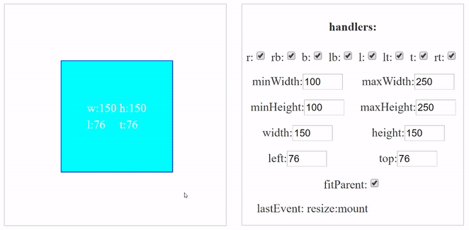

# VueResizable

[](https://npmjs.com/package/vue-resizable)
[](https://www.npmjs.com/package/vue-resizable)
[](LICENSE.md)

 

> Vue component that allows you to resize and drag elements

### Demo

<a href="https://nikitasnv.github.io/vue-resizable/" target="_blank">Demo page</a>\
<a href="https://codesandbox.io/s/13qp7xk787" target="_blank">CodeSandbox</a>\
<a href="https://codepen.io/nikitasnv/pen/YzPXKNw" target="_blank">Material window</a>

## Installation

```sh
npm install vue-resizable --save
```

This source tree and its builds target **Vue 3** (`vue >=3.2.13 <4`). Vue 2 requires a compatible older release; see [#37](https://github.com/nikitasnv/vue-resizable/issues/37).

The package's `import` export points to the ESM build and supports import and server rendering without a browser DOM. The `module` field also points to ESM for older bundlers. The `require` export keeps the existing UMD entry; the public `dist/*`, `src/*`, and `package.json` subpaths remain available. Styles are included automatically in a browser. For a browser script tag, the UMD global exposes the component as `window["vue-resizable"].default`.

## Basic usage

```vue
<template>
    <vue-resizable>
        <div class="resizable-content"></div>
    </vue-resizable>
</template>

<script>
import VueResizable from 'vue-resizable'

export default {
    name: "YourApp",
    components: {VueResizable}
}
</script>

<style scoped>
    .resizable-content {
        height: 100%;
        width: 100%;
        background-color: aqua;
    }
</style>
```

## Properties


| Property            |  Data attribute    | Type    | Default | Description                                                                                                                                                                                                                                                                           |
|:--------------------|------|:--------|:--------|:--------------------------------------------------------------------------------------------------------------------------------------------------------------------------------------------------------------------------------------------------------------------------------------|
| width               |   w   | [Number, String] | undefined   | Width in pixels, CSS length/percentage, or 'auto'
| minWidth            |   minW   | [Number, String]  | 0    | Minimum width in pixels or a CSS length/percentage |
| maxWidth            |   maxW    | [Number, String] | undefined   | Maximum width in pixels or a CSS length/percentage
| height               |  h   | [Number, String]  | undefined    | Height in pixels, CSS length/percentage, or 'auto'                                                                                                                                                                                                                    |
| minHeight        | minH | [Number, String]  | 0       | Minimum height in pixels or a CSS length/percentage |
| maxHeight    | maxH | [Number, String]  | undefined       | Maximum height in pixels or a CSS length/percentage |
| left          |   l    | [Number, String] | 0    | Offset left from parent                                                                                                                                                                                                                                                     |
| top       | t | [Number, String] | 0   | Offset top from parent          
| active     |    | Array | ['r', 'rb', 'b', 'lb', 'l', 'lt', 't', 'rt']   | Active handlers for resize    
| fitParent    |     | Boolean | false  | Respect parent's size on resizing and dragging
| lockAspectRatio | | Boolean | false | Preserve the width/height ratio during resizing
| step | | [Number, String] | 0 | Resize increment in CSS pixels (number) or parent percentage (string); 0 disables snapping |
| dragSelector | dragElements  |  String | undefined | Drag selector; omit or unset to prevent starting a drag
| dragCancelSelector | | String | undefined | Additional selector for descendants that must not start a drag
| maximize | | Boolean | false| Maximize element to parent size
| disableAttributes | calcMap | Array | [] | Disable changes to attributes, Available values: ['l', 't', 'w', 'h']

Interactive elements (`input`, `textarea`, `select`, `button`, links, and editable content) keep their native behavior inside a drag area. For a custom editor or control, exclude its subtree:

```vue
<vue-resizable drag-selector=".window-content" drag-cancel-selector=".custom-editor">
  <div class="window-content">
    <div>Drag here</div>
    <div class="custom-editor">...</div>
  </div>
</vue-resizable>
```

Assigned CSS sizes such as `75%` and `calc(50% - 20px)` are resolved to pixels on mount or when the prop changes. They do not automatically follow later parent size changes. A manual resize also works in pixels. Numeric and resolved CSS sizes are clamped when size props or min/max limits change. `auto` remains CSS-driven until resizing starts. While maximized, geometry updates apply to the saved restore state; echoed values matching the displayed geometry are ignored.

`minWidth`, `minHeight`, `maxWidth` and `maxHeight` also accept CSS lengths and expressions, such as `66vw`, `50vh`, `75%`, `20rem`, or `calc(100vw * 2 / 3)`. These limits are recalculated when the props, viewport, or parent size change. Increasing a minimum or decreasing a maximum clamps the current size; relaxing a limit does not resize it automatically. Percentages use the CSS containing block. Height limits containing percentages require a definite containing-block height for components in normal flow; otherwise they are ignored, matching CSS behavior and avoiding circular sizing. An `auto` height is also left unconstrained by `fitParent` when the parent's height depends on its contents. For maximums, `none` removes the limit and zero retains the existing unlimited behavior; a zero minimum allows shrinking to zero. `auto` sizes also respect the resolved limits. Maximums and parent boundaries take precedence over incompatible minimums. Maximize still fills the parent and applies updated limits to the saved restore size.

```vue
<vue-resizable min-width="20vw" min-height="10rem" max-width="calc(100vw * 2 / 3)" max-height="80vh" />
```

Use `:step="20"` to resize in 20px increments. Changes snap to the nearest step relative to the measured size at the start of the gesture, including when the starting size is not a multiple of the step. Fractional steps are supported. Minimum, maximum and parent boundaries take precedence and can produce a final size between steps. With `lockAspectRatio`, horizontal and corner handles step the width; vertical-only handles step the height, while the other dimension follows the ratio. Changes to `step` take effect on the next gesture. Dragging and external geometry updates keep their existing behavior.

Use `step="10%"` for a percentage step. It is resolved separately against the parent's client width and height (including padding, excluding borders) at the start of each gesture. For a 300×200 parent, `10%` gives 30px width steps and 20px height steps. The resolved steps stay fixed during that gesture; the next gesture uses the current parent size. `0%` disables snapping. Only numbers and percentage strings are supported for `step`.

## Events

| Name            |  Payload   |  Description                                                                                                                                                                                                                                                                           |
|:--------------------|-------------|:--------------------------------------------------------------------------------------------------------------------------------------------------------------------------------------------------------------------------------------------------------------------------------------|
| mount               |   [eventName,left,top,width,height]      | Called after the component is mounted 
| destroy               |   [eventName,left,top,width,height]      | Called before the component is destroyed 
| resize:start               |   [eventName,left,top,width,height]      | Called after clicking on one of the active handlers 
| resize:move               |   [eventName,left,top,width,height]      | Called when a handler is being dragged
| resize:end               |   [eventName,left,top,width,height]      | Called when the mouse button was released after resize
| drag:start | [eventName,left,top,width,height] | Called after clicking on one of the drag elements
| drag:move |  [eventName,left,top,width,height] | Called when a drag element is being dragged
| drag:end | [eventName,left,top,width,height] | Called when the mouse button was released after drag
| maximize | [eventName,left,top,width,height, state] | Called when "maximize" state changed

## Development


To begin development, run:

``` bash
npm install 
npm run dev
```
It starts [webpack-dev-server](https://github.com/webpack/webpack-dev-server) on `localhost:8080` with [Demo](./docs) page.

Run the regression tests with Node.js 22.12+:

```bash
npm test
npm run eslint:check -- --ext .js,.mjs,.vue src docs tests vite.config.mjs
npm run build
```

Browser tests install the archive produced by `npm pack` into a separate Vue/Vite application. They check both development and production imports, the existing UMD build, CSS dimensions, resizing, dragging, and text input:

```bash
npx playwright install --with-deps chromium
npm run test:browser
```

The consumer installation uses npm's offline cache populated by `npm install`. The tests build the library first and do not publish anything.

External geometry changes stop pointer handling immediately. The corresponding end event is emitted after the entire prop batch and CSS-size conversions have settled, carrying the final geometry. Echoing the current geometry from move events keeps the gesture active. Limit updates affect only the corresponding axis and retain the parent boundary priority.

Changing `maximize` ends an active gesture with its corresponding end event. Dragging out of maximize restores `auto` dimensions after the DOM update; a canceled gesture does not resume afterward. Drag elements inserted or updated in slots are detected automatically and marked with `data-resizable-drag`; their classes are preserved.

Dragging and resizing use Pointer Events. A canceled pointer or window blur ends the current interaction and emits the corresponding `drag:end` or `resize:end` event.

With `fitParent`, resizing and dragging respect the outer box, including padding and borders. Numeric dimensions and min/max limits retain their CSS sizing meaning for the selected `box-sizing`. The parent boundary takes precedence when `minWidth` or `minHeight` cannot fit. A maximum of `0` means unlimited, as in earlier versions.

`lockAspectRatio` preserves the ratio of the measured CSS width and height at the start of each resize. CSS sizes such as `auto` and percentages are measured before resizing. Side handles also resize the other dimension, keeping that dimension's starting position fixed; corner handles follow the original diagonal and keep the opposite corner fixed. Both axes' min/max and parent constraints apply together, with upper bounds taking precedence over incompatible minimums. Padding and borders count toward parent boundaries. If either size is disabled through `disableAttributes`, locked resizing is blocked. If either starting dimension is zero, that gesture uses ordinary resizing. Changes to `lockAspectRatio` take effect on the next gesture; dragging, maximize and external prop updates retain their existing behavior.

## License

This project is licensed under the MIT License - see the [LICENSE.md](LICENSE.md) file for details.


     
